# Schémas des enchaînements des endpoints – API ALS (MVP)

Ce document complète le [guide des endpoints](ENDPOINTS.md) avec des schémas. Ils sont écrits en **Mermaid** : GitHub et VS Code les affichent automatiquement (dans VS Code, l'aperçu *Ctrl + Shift + V* nécessite l'extension « Markdown Preview Mermaid Support »).

Dans les schémas, « API » désigne le back-end vu par le front : Agent, Routeur et KMS. Le mock MSW joue ce rôle aujourd'hui.

## Sommaire

1. [Vue d'ensemble : qui appelle quoi](#1-vue-densemble--qui-appelle-quoi)
2. [Kiosque : démarrage et menu](#2-kiosque--démarrage-et-menu)
3. [Kiosque : retrait](#3-kiosque--retrait)
4. [Kiosque : dépôt](#4-kiosque--dépôt)
5. [Contrôles d'un dépôt ou d'un retrait](#5-contrôles-dun-dépôt-ou-dun-retrait)
6. [Portail : traitement d'un incident](#6-portail--traitement-dun-incident)
7. [Portail : mise en service d'un kiosque](#7-portail--mise-en-service-dun-kiosque)
8. [Portail : création d'un service](#8-portail--création-dun-service)
9. [Calcul de la disponibilité d'un service](#9-calcul-de-la-disponibilité-dun-service)
10. [Ce qui recalcule la disponibilité](#10-ce-qui-recalcule-la-disponibilité)
11. [Cycle de vie d'un kiosque](#11-cycle-de-vie-dun-kiosque)
12. [Modèle de données du KMS](#12-modèle-de-données-du-kms)

---

## 1. Vue d'ensemble : qui appelle quoi

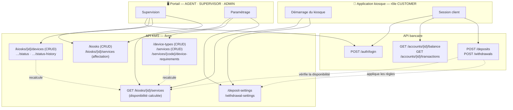

---

## 2. Kiosque : démarrage et menu

Le kiosque charge son menu et ses paramètres **avant** l'arrivée d'un client, puis il les rafraîchit régulièrement : la disponibilité change quand un périphérique tombe en panne.

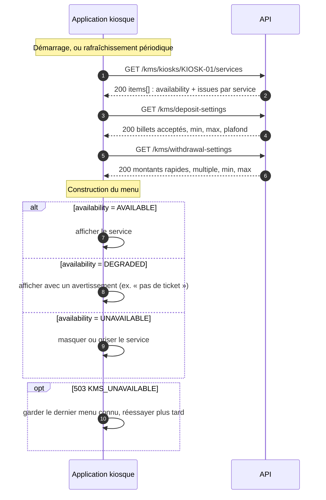

---

## 3. Kiosque : retrait

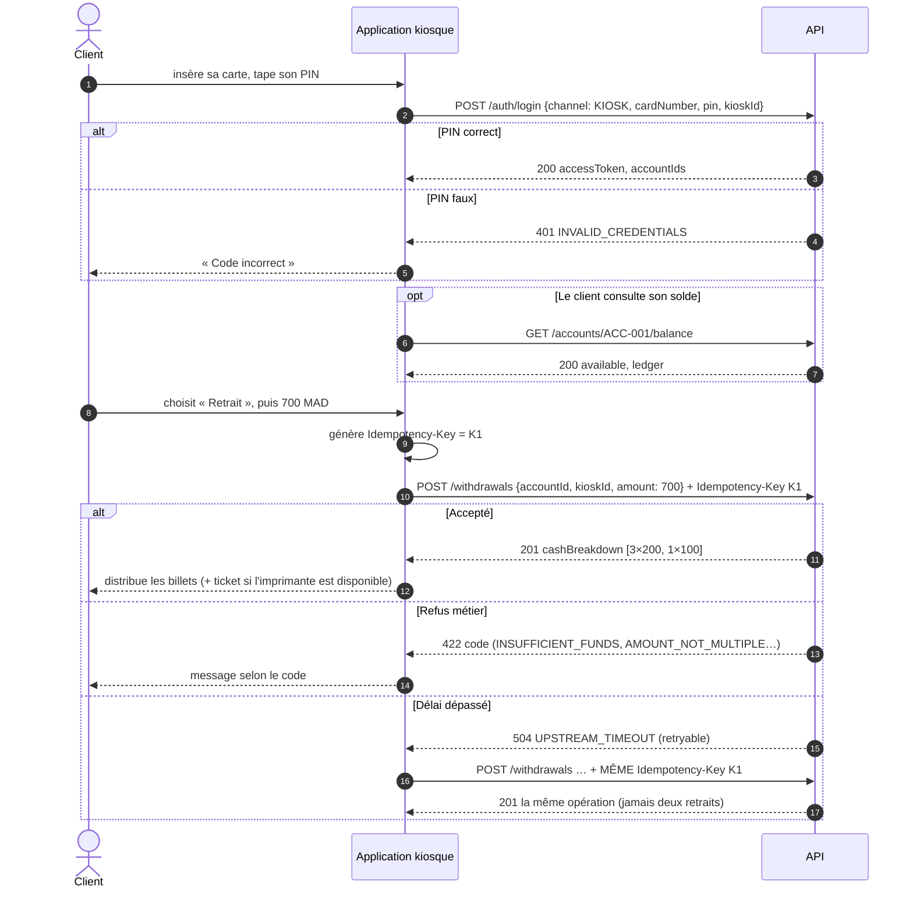

---

## 4. Kiosque : dépôt

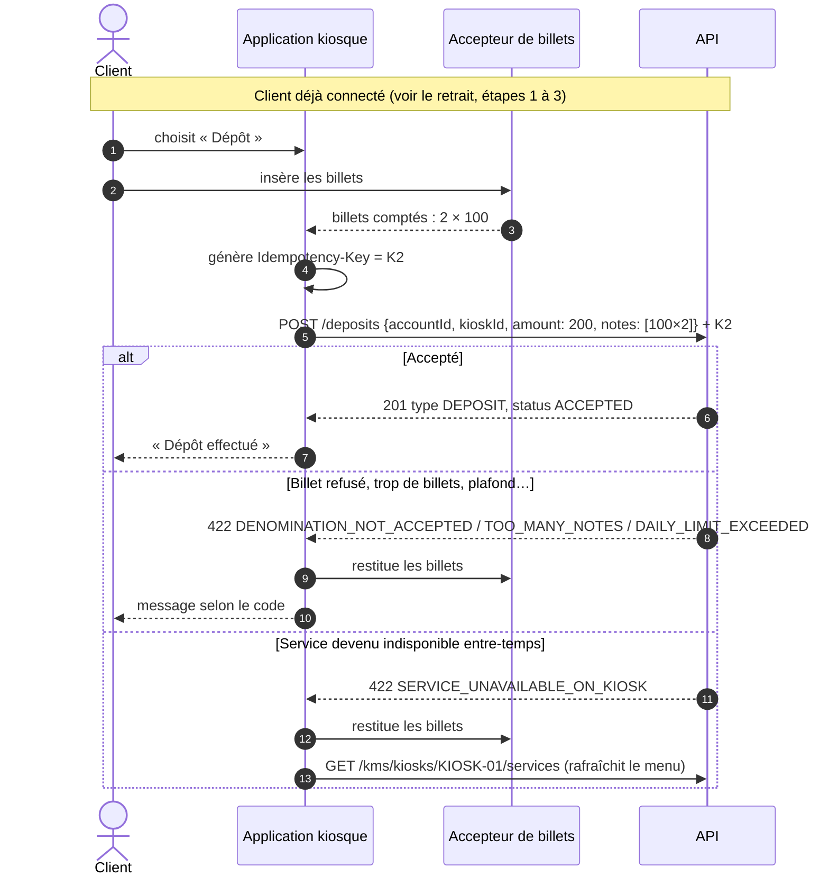

---

## 5. Contrôles d'un dépôt ou d'un retrait

Ordre des contrôles appliqués par `POST /deposits` et `POST /withdrawals` :

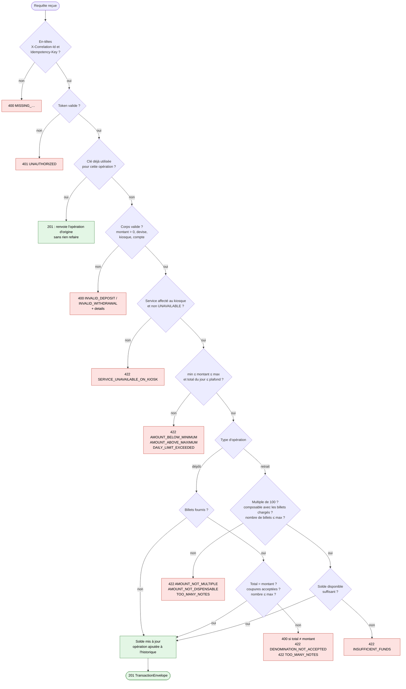

---

## 6. Portail : traitement d'un incident

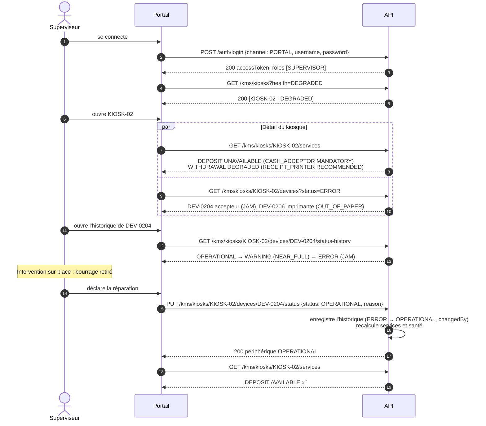

---

## 7. Portail : mise en service d'un kiosque

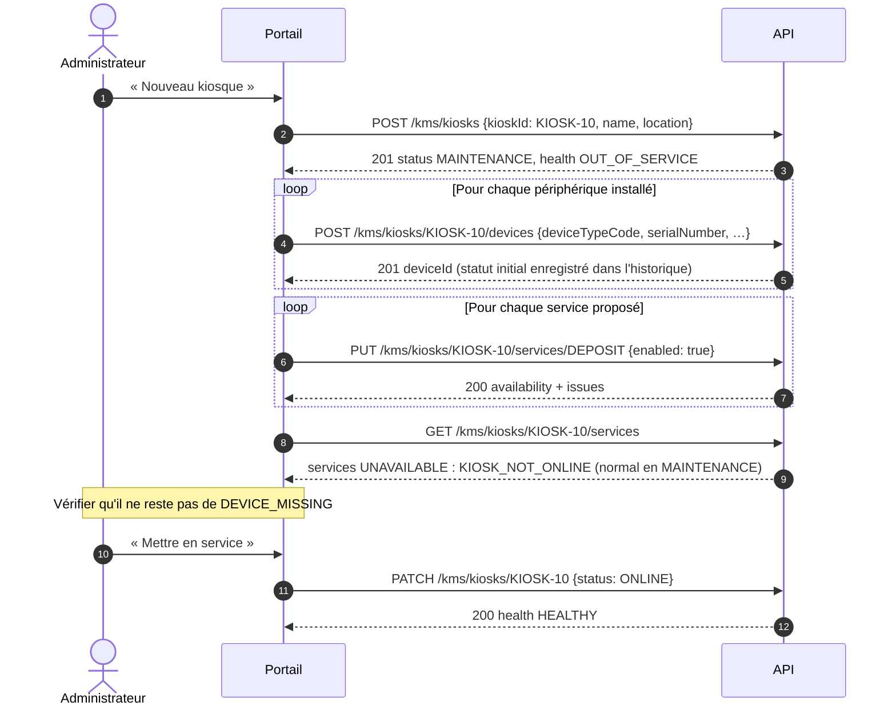

---

## 8. Portail : création d'un service

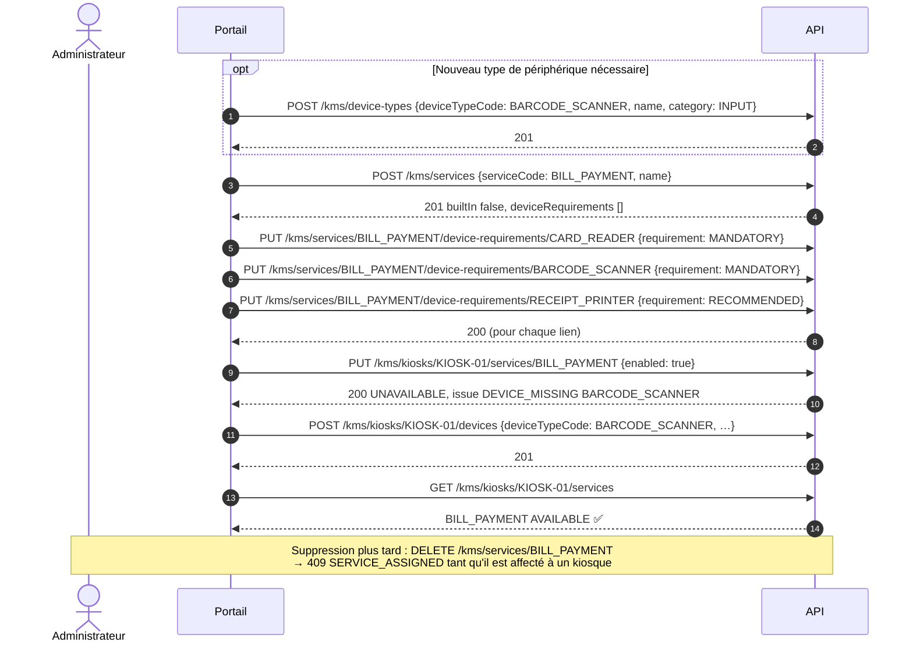

---

## 9. Calcul de la disponibilité d'un service

Ce calcul est fait par l'API pour chaque service affecté à un kiosque, à chaque lecture de `GET /kms/kiosks/{id}/services`.

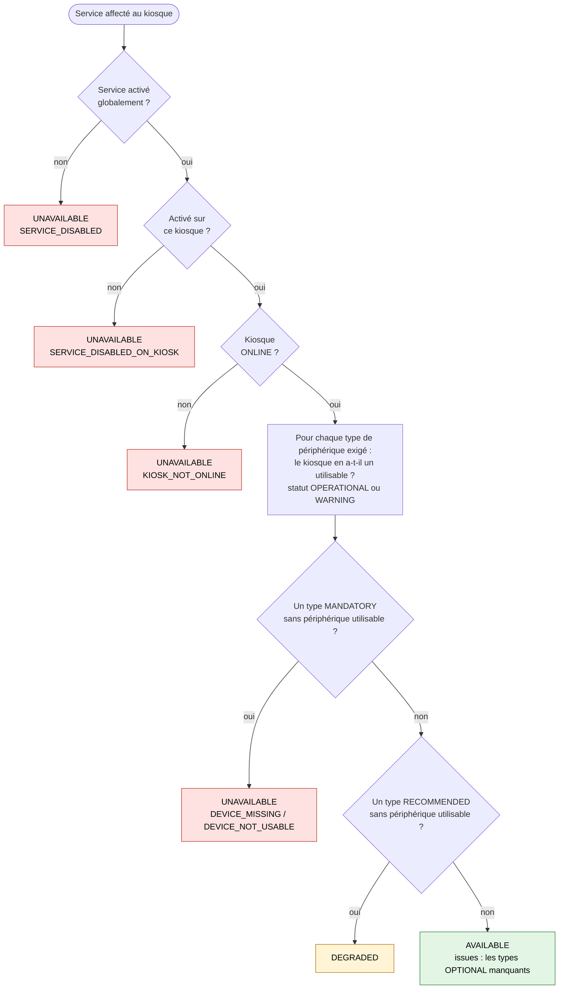

La santé du kiosque en découle :

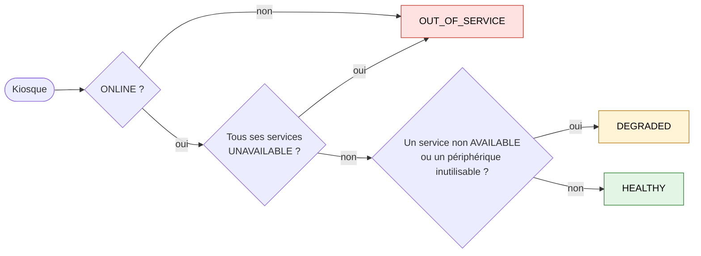

---

## 10. Ce qui recalcule la disponibilité

Ces écritures modifient immédiatement ce que renvoient `GET /kms/kiosks/{id}/services`, ainsi que `health` dans `GET /kms/kiosks`. Elles décident donc de ce que le kiosque peut proposer et de ce que `POST /deposits` et `POST /withdrawals` acceptent.

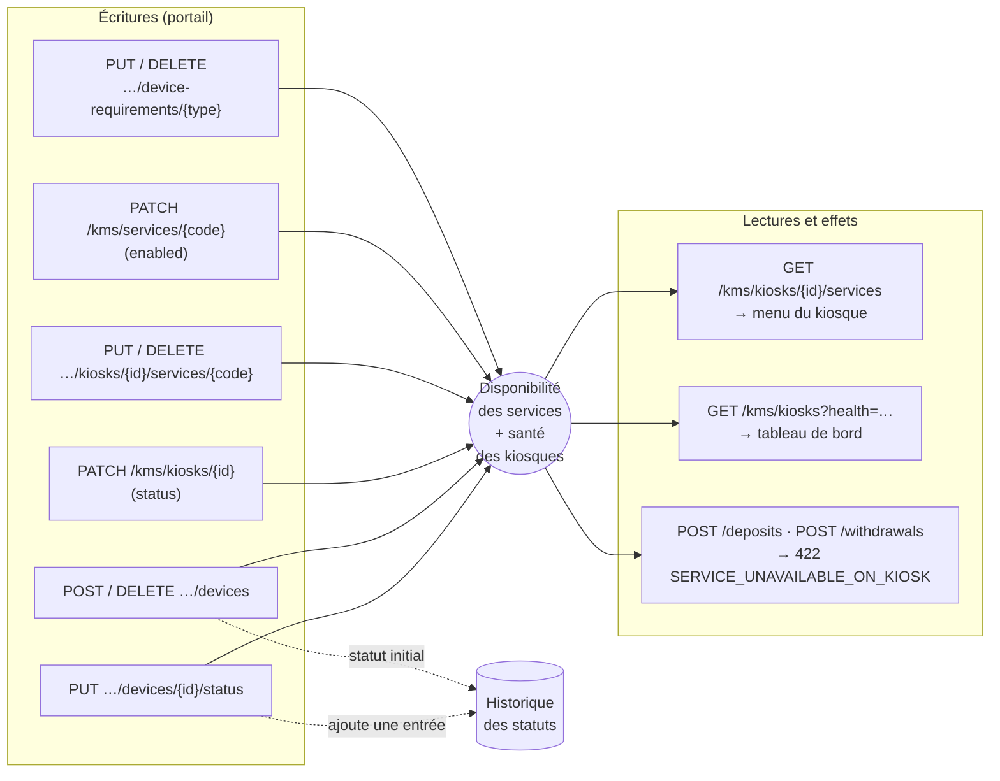

---

## 11. Cycle de vie d'un kiosque

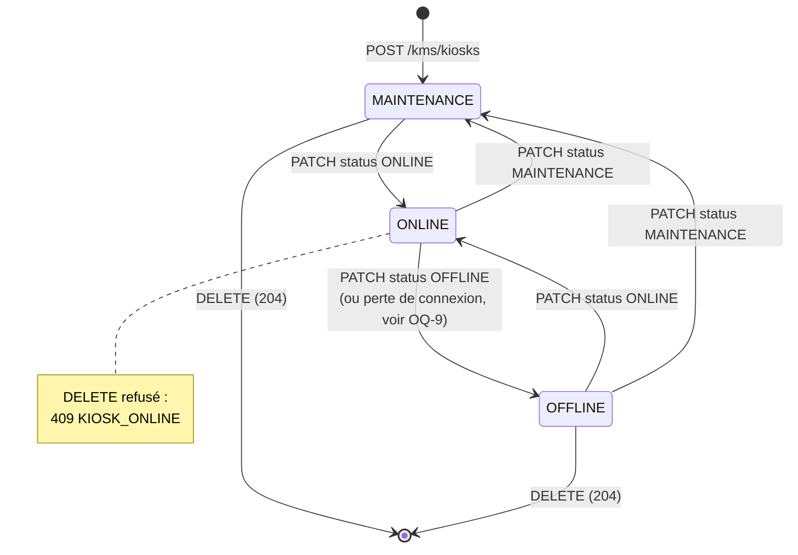

Cycle d'un périphérique : chaque flèche est un appel `PUT …/status`, qui laisse une trace dans l'historique.

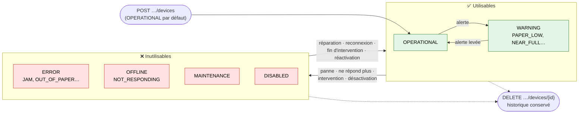

En réalité, toute transition entre deux statuts est permise ; le schéma montre les cas usuels. Seuls `OPERATIONAL` et `WARNING` comptent comme utilisables.

---

## 12. Modèle de données du KMS

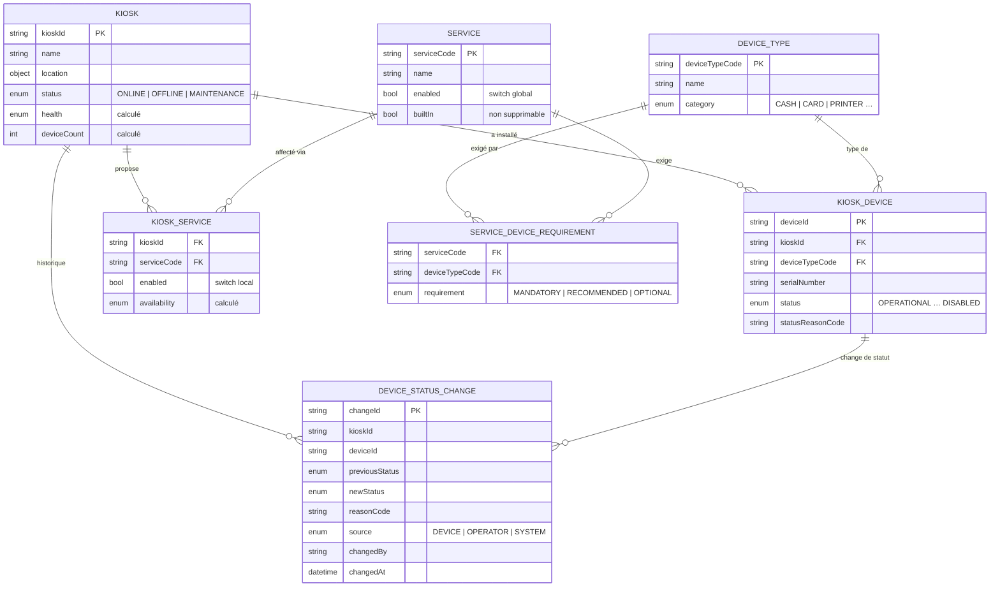

Les paramètres de dépôt et de retrait (`/kms/deposit-settings`, `/kms/withdrawal-settings`) sont deux objets globaux, sans lien avec un kiosque particulier (voir OQ-7 dans `DECISIONS.md`).
